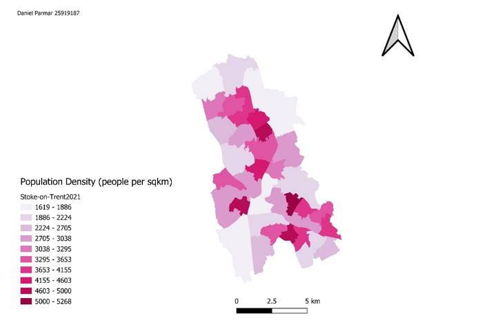

# population-density-stoke
 A choropleth map to show the population density of Stoke-On-Trent

## Data
Population and data from the 2021 Census (Officce for National Statistics)
Boundaries from 2021 Ward boundary data (Office for National Statistics)
## Tools
Made using QGIS
## What it shows
This choropleth map shows the population density of Stoke-on-Trent in 2021, measured in people per kilometer squared. Density ranges from 1,619 to 5,268 people per sq km, split into ten classes. Darker pink areas are more densely populated than lighter areas. The densest areas are in the central (Hanley) and north-central (Tunstall) parts of the city, with another cluster in the south-east (longton and Meir). The lightest areas are at the northern tip and around the southern outskirts, which hold less housing and infrastructure.
